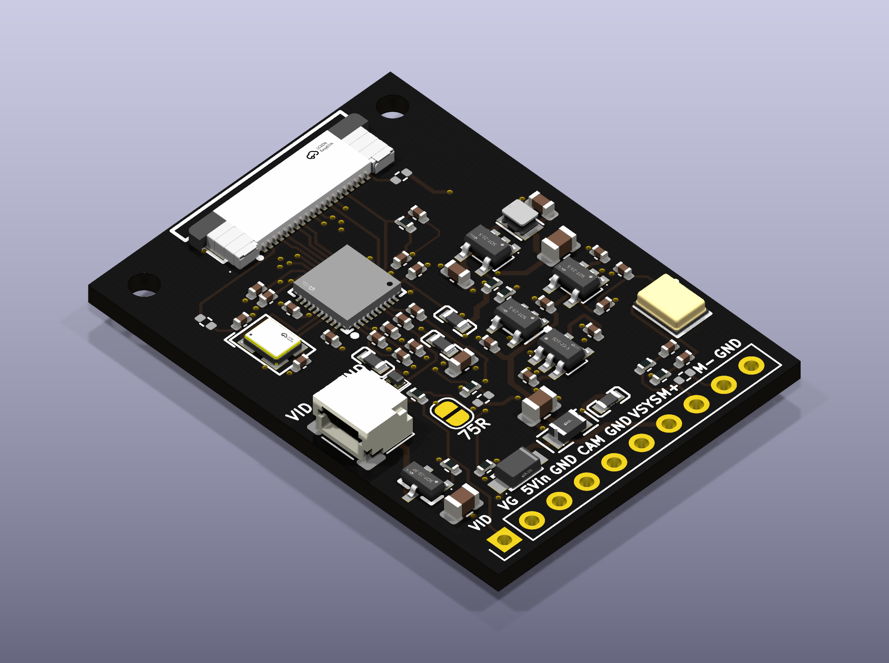
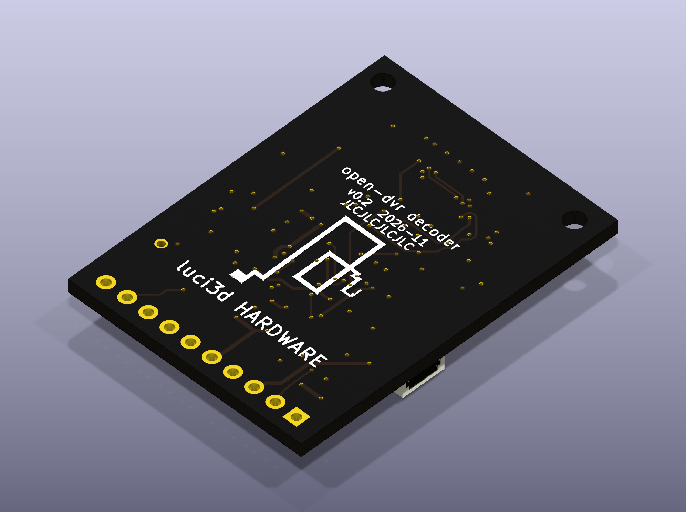

# Decoder board (phase 1): the DIY kit board

A small board that turns an analog FPV camera signal (CVBS) into MIPI CSI-2 for a Luckfox Pico, and carries the DVR's microphone. Plugged into a Luckfox Pico Pro/Max with the camera ribbon cable and a few wires, it makes a complete DVR module. It is **our first piece of hardware and the DIY kit board** (decided 2026-11-19): video decoder and mic, on a separate board connected by cable. The IMU stays a separate breakout for later ([roadmap phase 4](../ROADMAP.md#phase-4-imu-breakout)).

Status: **schematic v0.1, PCB placed and routed v0.1, 2026-11-19** ([`kicad/`](kicad/), see [Schematic](#schematic) and [PCB](#pcb)). Next: a review in KiCad, then a JLC order.

| Top | Bottom |
|---|---|
|  |  |

KiCad 3D renders of v0.2 with all parts fitted (U1 and MK1 included, though they are soldered at home).

```
FC video line ──(parallel tap)──► J2/J3 ──► input network ──► TP9950 ──MIPI 2 lanes + I2C──► J1 FPC ──► Luckfox camera connector
FC 5 V ──► J2/J3 ──► reverse-polarity FET ──► 5 V ──► 3.3 V LDO, 1.2 V buck, camera 5 V out (J3), 5 V to Luckfox VSYS (J3)
MEMS mic ──► J3 ──(3 short wires)──► Luckfox codec pads 3/4 + GND
```

## Connectors

| Ref | Type | Pins | Goes to |
|---|---|---|---|
| J1 | FPC 0.5 mm 20-pin, **top contact** (05B20U20P, JLC-assembled) | Luckfox camera pinout, pin n = Luckfox pin n | Luckfox camera connector, stock opposite-side cable |
| J2 | SH 1.0 mm 3-pin (JLC-assembled) | 1 Video, 2 5 V in, 3 GND | The FC: camera video line (parallel tap) and 5 V; same harness as the COOAI DVR |
| J3 | One row of 10 holes, 2.54 mm, along the bottom edge (not assembled) | see below | Wires, or a 10-pin header for a breadboard |

J3, labelled on the silkscreen, left to right:

| Pin | Label | Net | Goes to |
|---|---|---|---|
| 1 | VID | Video in | Same as J2 pin 1 |
| 2 | VG | Video ground sense (VID_REF) | The camera's ground at the tap, on its own wire twisted with VID. Optional: R16 ties it to GND (see [Video input network](#video-input-network)) |
| 3 | 5Vin | 5 V in | Same as J2 pin 2 |
| 4 | GND | GND | |
| 5 | CAM | Camera 5 V out, through the polyfuse | A camera on the bench |
| 6 | GND | GND | |
| 7 | VSYS | 5 V out | Luckfox **VSYS (header pin 39)**: one 5 V feed from the FC powers both boards. VSYS is the Luckfox's 5 V system rail; its USB-C input reaches it through a Schottky diode, so USB can stay plugged in |
| 8 | M+ | Mic + | Luckfox codec pad 3 (MIC0+) |
| 9 | M− | Mic − | Luckfox codec pad 4 (MIC0−) |
| 10 | GND | GND | Luckfox header pin 23 (mic ground) |

The schematic first had four separate hole groups (J3–J6). They didn't fit across the board edge, so they became one 10-hole row, which is also easier for a breadboard.

## Chip: TP9950 instead of TP2850

| | TP2850 (COOAI board) | TP9950 |
|---|---|---|
| Datasheet | Not found | Preliminary datasheet, rev A (2018-12-28) |
| Sourcing | No listing found anywhere | Listed in JLCPCB's assembly library (C2852602 and others), so JLC can place it |
| Package | QFN, about 10 pins per side in the photo, so probably QFN40 | EPQFN40, 5 x 5 mm, 0.4 mm pitch, exposed pad 3.7 mm |
| Linux driver | None | Rockchip's open TP9950 driver, the one the roadmap already plans to use |
| Registers | Our probes found the same CVBS tables as the TP9950 driver | |

**Pick: TP9950.** It is the chip the driver is written for, it has a datasheet, and it can be bought assembled. The TP2850 on the COOAI board is still useful as a working reference: same package size and same register tables, so it is most likely the same pinout. That needs a continuity check (see [Checks on the COOAI board](#checks-on-the-cooai-board)).

The datasheet is marked confidential, so it is **not** stored in this repo. Only the facts needed for the design are copied here.

## TP9950 pin map

Pin numbers from the TP9950 datasheet (top view, pin 1 = AVDD33, counter-clockwise). "Our net" is what each pin connects to on this board.

| Pin | Name | Type | Our net / connection |
|---|---|---|---|
| 1 | AVDD33 | Power | `3V3A`: 3.3 V through a ferrite bead, 100 nF + 1 µF at the pin |
| 2 | AVDD12 | Power | `1V2A`: 1.2 V through a ferrite bead, 100 nF + 1 µF at the pin |
| 3, 4 | PTZ1, PTZ2 | Out | Not connected (PTZ data over coax, not used) |
| 5, 6 | DIAG1, DIAG2 | In | Not connected (input fault detection, not used). Check the datasheet's "use as directed" note before layout |
| 7 | VIN1 / VIN1P | Analog in | Video input, AC-coupled 0.1 µF (see input network) |
| 8 | VIN2 / VIN1N | Analog in | Pseudo-differential return: 0.1 µF to the video ground pad (to confirm, see below) |
| 9, 10 | VIN3-4 / VIN2P/N | Analog in | Not connected |
| 11, 28, 40 | DVDD | Power | `1V2D`: 1.2 V core, 100 nF at each pin + 10 µF bulk |
| 12, 13 | VS, HS | Out | Not connected (parallel output not used); test pads optional |
| 14, 27, 35 | VDD_IO | Power | `VIO`: 1.8 V from U4 (the Luckfox camera I/O is 1.8 V); 0 Ω option for 3.3 V, not fitted |
| 15 | RSTB | In, low active | Host reset line from the FPC (pin 16), plus 10 kΩ pull-up to `VIO` and 100 nF to GND (power-on reset if the host leaves it floating) |
| 16 | SCL | In | Host I2C SCL from the FPC (pull-ups on the Luckfox; footprints for our own, not fitted) |
| 17 | SDA | Bidir | Host I2C SDA, same as SCL |
| 18 | IRQ | Out | Test pad (not needed by the driver) |
| 19, 20, 29-34 | VD1_0-7 | I/O | Not connected (parallel BT.656 output, not used) |
| 21 | CKN | Out | MIPI clock − |
| 22 | CKP / CLKO | Out | MIPI clock + |
| 23, 24 | D0N, D0P | Out | MIPI lane 0 −/+ |
| 25, 26 | D1N, D1P | Out | MIPI lane 1 −/+ |
| 36 | XTI | In | 27 MHz crystal, or a 27 MHz clock in (see clock) |
| 37 | XTO | Out | 27 MHz crystal |
| 38 | SAD | In | GND → I2C address `0x44` (VIO → `0x45`). `0x44` is what the COOAI board and our driver tables use |
| 39 | TEST | In | GND (to confirm on the COOAI board) |
| EP | GND | | Ground, with a via array under the pad |

## Power

From the datasheet:

| Rail | Range | Current (typ.) |
|---|---|---|
| AVDD33 | 3.15–3.45 V | 24 mA |
| AVDD12 | 1.1–1.3 V | 60 mA |
| DVDD | 1.1–1.3 V | 84 mA at 720p and below (140 mA at 1080p30) |
| VDD_IO | 3.15–3.45 V or 1.7–2.0 V | 9 mA |

So the chip needs about **35 mA at 3.3 V and 145 mA at 1.2 V**, roughly 0.3 W. The power table in the datasheet also has a limit on the difference between VDD_IO and AVDD that didn't extract cleanly; read it on the PDF before choosing 1.8 V IO.

**Plan:** power the board from its own **5 V pad**, the same one that feeds the camera, instead of the Luckfox connector's 3.3 V. This answers the roadmap's open question: the board doesn't depend on how much the Luckfox's 3.3 V can supply. On the bench, the 5 V comes from the Luckfox VBUS pin; on a quad, from the FC's 5 V pad.

| Rail | Part type | Why |
|---|---|---|
| 3.3 V (`3V3A`, and `VIO` if 3.3 V) | Low-noise LDO, 5 V → 3.3 V, 150–300 mA, SOT-23-5 | Only about 35 mA, so about 0.06 W lost; quiet supply for the analog front end |
| 1.2 V (`1V2A`, `1V2D`) | Small buck, 5 V → 1.2 V, 2.5–5.5 V input (SY8089 / TLV62569 class), 2.2 µH | An LDO from 3.3 V would burn about 0.3 W at 145 mA. Ferrite + caps split it into analog and digital 1.2 V |
| 1.8 V (`VIO`) | Tiny LDO, 3.3 V → 1.8 V | The Luckfox camera I2C and reset are 1.8 V (see below) |
| Camera power out | 5 V pass-through, ferrite + 22 µF, polyfuse | See [Camera input in the roadmap](../ROADMAP.md#camera-input-standard-3-wire-analog-fpv-camera-v-gnd-video) |

Input protection on the 5 V pad: 5 V TVS, bulk 10–22 µF, and reverse-polarity protection. The COOAI board has an SMA-package diode marked `BV` next to its connector, most likely for the same job.

## I/O voltage

**The Luckfox camera I/O is 1.8 V** (Luckfox Pico Pro/Max schematic): the SoC's camera pins are on the `VCCIO7` domain, powered from `VCC_1V8`, and the camera I2C pull-ups (R28, R29, 4.7 kΩ) go to `VCC_1V8`.

So `VIO` = **1.8 V**: U4 (1.8 V LDO) is fitted, and the TP9950's I2C and reset talk to the Luckfox directly, with no level shifter. The 0 Ω option to run `VIO` from 3.3 V stays on the board, not fitted.

Still to read on the datasheet PDF: the power table's limit on the difference between VDD_IO and AVDD, which didn't extract cleanly. The datasheet does list 1.8 V as a supported VDD_IO.

## Clock

- **27 MHz fundamental crystal**, ±50 ppm, CL 20 pF, ESR about 80 Ω (datasheet values). 3225 package.
- Load caps: start at 33 pF each (2 × (20 pF − about 4 pF stray)); copy the COOAI board's values if they can be measured.
- The COOAI board uses a 27 MHz crystal next to its decoder (the can marked `R27.0` in the photo).
- **Optional:** XTI also accepts a 27 MHz clock in. Add a 0 Ω (not fitted) from the FPC's MCLK pin to XTI, in case we ever want to drop the crystal and have the Luckfox drive it. The crystal is the default because it doesn't depend on the host's clock setup.

## Video input network

```
Video pad ──┬── ESD diode (<1 pF) ── GND
            ├── 75 Ω ── JP1 (open by default) ── GND
            └── 0.1 µF ── VIN1P (pin 7)

J3 VG (camera ground sense) ──┬── 0.1 µF (C13) ── VIN1N (pin 8)
                              └── 75 Ω (R16) ── GND
```

- The datasheet asks for the input to be AC-coupled with **0.1 µF**.
- **JP1 is open by default:** on the quad the DVR is a parallel tap, and the FC (or VTX) already terminates the line (see [Requirements](../ROADMAP.md#requirements)). Close it on the bench when the camera is wired straight in.
- **Pseudo-differential input (v0.2):** VIN1N's cap C13 goes to its own net, VID_REF, which leaves the board on J3 VG.
  - **Wiring:** solder a wire from VG to the camera's ground at the same point where VID is tapped, and twist it with the VID wire. That wire carries no power current, so it holds the camera's ground voltage. The chip then measures the video against the camera's ground, and ground noise between the quad and the DVR (ESC and camera currents in the ground wires) cancels.
  - **R16 (75 Ω to GND):** keeps the input working when VG isn't wired, and then it behaves like v0.1. With the wire connected, only a fraction of a milliamp of ground noise flows through R16, which the sense wire swamps.
  - **To compare:** short R16 with solder or a 0 Ω and you're back to the v0.1 behaviour, so the two can be A/B tested on the bench.
  - **Still to confirm:** the datasheet section on the negative input didn't extract cleanly. Check it on the PDF and on the COOAI board.

## Host connector (FPC)

From the Luckfox Pico Pro/Max schematic, connector `H1` (`CAM`), **0.5 mm, 20 pins**:

| Pin | Luckfox net | Our board |
|---|---|---|
| 1 | GND | GND |
| 2 | `MIPI/LVDS_MCLK0` (SoC `VI_CIF_CLKO_M0` / GPIO3_C4, through 22 Ω) | Optional 0 Ω to XTI, not fitted |
| 3 | GND | GND |
| 4 | `MIPI/LVDS_D0_P` | D0P (TP9950 pin 24) |
| 5 | `MIPI/LVDS_D0_N` | D0N (pin 23) |
| 6 | GND | GND |
| 7 | `MIPI/LVDS_CLK_P` | CKP (pin 22) |
| 8 | `MIPI/LVDS_CLK_N` | CKN (pin 21) |
| 9 | GND | GND |
| 10 | `MIPI/LVDS_D1_P` | D1P (pin 26) |
| 11 | `MIPI/LVDS_D1_N` | D1N (pin 25) |
| 12 | GND | GND |
| 13 | `MIPI_I2C_SCL` (4.7 kΩ to 1.8 V on the Luckfox) | SCL (pin 16) |
| 14 | `MIPI_I2C_SDA` (4.7 kΩ to 1.8 V on the Luckfox) | SDA (pin 17) |
| 15 | GND | GND |
| 16 | `MIPI/LVDS_RST` (SoC GPIO3_C5) | RSTB (pin 15) |
| 17, 18 | GND | GND |
| 19, 20 | `VCC_3V3` | Not used for power; optional 0 Ω to our 3.3 V rail, not fitted |

**Cable** (measured on the bench, 2026-11-17, with the cable plugged into the Luckfox and a meter on the 3.3 V header pin):
- The stock Luckfox camera cable (0.5 mm, 20 conductors) has its contacts on **opposite faces** at its two ends.
- At the free end, looking at the contacts with the cable's tip pointing toward you (the cable running away from you to the Luckfox): **pins 19–20 (3.3 V) are on the right**, so pin 1 is on the left.

**J1 is a top-contact connector** (HanElectricity 05B20U20P, LCSC C22435648), changed from the bottom-contact 05A20L20P during layout (2026-11-19):
- **Cable fit:** a top-contact connector takes the cable the way it naturally lies, contacts facing up. The bottom-contact part needed the cable turned over.
- **MIPI polarity:** with a top-contact J1, seen from above with the cable coming in from the top edge, **Luckfox pin 1 lands on the left**, and every MIPI pair's + and − line up with the TP9950's pins. With the bottom-contact part, all three pairs came out reversed.
- **Mapping:** the cable enters opposite the solder leads (drawing and product photo). With the footprint turned 180° so the entry faces the board edge, pad 1 is on the left, so **J1 pad n = Luckfox pin n**.
- **Not double-sided:** some "double-sided contact" parts accept the cable either way up; upside down, that would short the Luckfox's 3.3 V to GND. A single-sided part avoids that.

**Spare cables** must also be **opposite-side** (sometimes sold as "Type B" or "reverse"), 0.5 mm, 20 conductors. A same-side cable mirrors the pin order and won't work with this layout.

Still to check: the Mini B uses the same 20-pin pinout (the SC3336 camera fits both, which suggests yes).

## Microphone

The mic goes on this board because it is the board that sits on the quad next to the video wiring, and it already has clean local supplies. That saves a separate mic board for the DIY kit.

**Requirement** (from the COOAI board, see [bom-prelim.md](../dvr-recorder/docs/bom-prelim.md#microphone)): prop noise next to the motors is very loud; the COOAI mic input clipped up to 38 % of the time in flight. The mic must not overload before the SoC's input does.

**Where the audio goes:** the RV1106/RV1103 has a built-in audio codec. On the Luckfox Pico Pro/Max its pins come out to **test pads**:

| Pad | Net | SoC pin |
|---|---|---|
| P4 | `MIC0_P` | CODEC_MIC0P (34) |
| P5 | `MIC0_N` | CODEC_MIC0N (33) |
| P7 | `MIC1_P` | CODEC_MIC1P (36) |
| P8 | `MIC1_N` | CODEC_MIC1N (35) |
| P6 | `LINEOUT` | CODEC_LINEOUT (29) |
| P9 | `BIAS` (mic bias, from `VCC1V8_MICBIAS`) | CODEC_MICBIAS (32) |

**Where they are on the board** (confirmed by continuity to the SoC pins, 2026-11-17): the row of **four round gold pads** on the top side, next to the RTC battery connector, just above header pins 21–26. Numbered left to right with the camera connector on the left:

| Pad on the board | SoC pin | Net | Schematic pad |
|---|---|---|---|
| 1 | 29 | `LINEOUT` | P6 |
| 2 | 32 | Mic bias (1.8 V) | P9 |
| 3 | 34 | **`MIC0_P`** | P4 |
| 4 | 33 | **`MIC0_N`** | P5 |

MIC1 (P7, P8) isn't on these pads, and we don't need it.

**Wiring:** the camera FPC carries no audio, so the mic connects with **3 short twisted wires**: MIC+ → pad 3, MIC− → pad 4, GND → header pin 23 (the square pad just below; GND in the Pico pinout, check it beeps to GND). Check the Mini B too.

**Software:** the Luckfox wiki says the Pro/Max "does not expose" the audio pins, and its audio tutorial is for the Ultra W only. The stock image probably has the codec turned off, so expect to enable it in the device tree of our build.

**Plan A, analog mic (default):** Infineon IM73A135, 135 dB SPL overload point, IP57, bottom port, differential output.

### Mic limits (IM73A135V01 datasheet, V1.20)

| Item | Value | What it means for us |
|---|---|---|
| **Absolute max supply** | **3.0 V** | Never connect it to 3.3 V, not even on the bench |
| Supply, normal mode | 2.3–3.0 V (typ. 2.75 V) | Full performance: 135 dB SPL overload, 73 dB SNR. **We use 2.8 V** |
| Supply, low-power mode | 1.52–1.8 V | 130 dB overload. The mode is picked by the supply voltage. Nothing between 1.8 and 2.3 V is specified |
| Current | 170 µA typ., 230 µA max (normal mode) | Any small LDO does it |
| Supply ramp-up | reach final value within 5 ms | Fine for an LDO |
| Start-up time | 10–30 ms | The recorder drops the first ~50 ms of audio |
| Output DC level | 1.35 V on each output | Needs coupling caps: the codec inputs sit at their own bias |
| Output impedance | 250 Ω | |
| Output load | ≤ 100 pF per output and across; tested with 25 kΩ | No big filter caps on the outputs |
| Sensitivity | −38 dBV at 94 dB SPL (±1 dB) | 1 kHz |
| Output at 135 dB SPL | about 1.4 V rms differential (about 4 V peak-to-peak) | Probably more than the codec input takes at 0 dB gain (see below) |
| Pins | 1 Output+, 2 VDD, 3 Output−, 4 GND, 5 GND (sound port ring) | Matches the LCSC symbol |

**The Luckfox mic bias (pad 2, 1.8 V) can't power this mic:** 1.8 V is at the very top of low-power mode, and a little above it is unspecified. The 0 Ω option for it is removed; the mic always runs from our own 2.8 V LDO (U5). The ME6211C28 is ±2 %, so at most 2.86 V, under the 3.0 V limit.

**Codec input level, unknown:** the RV1106 codec's mic input full scale and input impedance aren't in anything we have (the datasheet copy at LCSC didn't download). Its analog supply is 1.8 V, so a full-scale input of roughly 1 V rms differential or less is likely. At 120 dB SPL (prop noise) the mic gives about 0.25 V rms, which is fine; near 135 dB it would clip the codec first. So the board has an **attenuator option**: a series resistor on each line (0 Ω fitted) and a resistor across the pair (not fitted). The breadboard test sets the values.

### Mic circuit (for the schematic)

```
3V3 ── U5 ME6211C28 (VIN, EN) ── 2V8_MIC                    1 µF on U5 in, 1 µF on U5 out
2V8_MIC ── MK1 pin 2 (VDD), 100 nF at the pin
MK1 pin 4, pin 5 ── GND (pin 5 is the ring around the sound port)
MK1 pin 1 (Out+) ── C 1 µF ── R13 0 Ω ──┬── MIC_P pad ──► Luckfox pad 3 (MIC0_P)
                                        R15 (not fitted, across the pair)
MK1 pin 3 (Out−) ── C 1 µF ── R14 0 Ω ──┴── MIC_N pad ──► Luckfox pad 4 (MIC0_N)
GND pad ──► Luckfox header pin 23
```

- **Coupling caps:** 1 µF X5R/X7R. The DC across them is small (1.35 V on the mic side, the codec's bias on the other), so microphonic pickup from vibration should be low; listen for it in the strapped-down motor test.
- **Footprint:** the LCSC footprint (named after the IM69D130, same package) matches the IM73A135 drawing: pad positions, pin 1 and 0.75 × 0.45 mm pads. Its sound hole was 0.7 mm; it's changed to the datasheet's **0.8 mm** in `kicad/lib/lcsc.pretty` (redo this if the footprint is downloaded again).
- **Pads:** MIC+, MIC−, GND at the board edge, next to the camera pads but away from the 1.2 V buck. Twist the three wires to the Luckfox.
- **Port hole:** cover it with acoustic mesh or foam against wind and prop wash.

### Bench test of the mic

No separate mic breakout: the first decoder boards are the test boards. With a 10-pin header in J3 the board plugs into a breadboard.

1. With 5 V on J3 pin 2, measure VDD at the mic's 100 nF cap (C14): 2.74–2.86 V.
2. Wire J3 pins 8, 9 and 10 (M+, M−, GND) to the Luckfox codec pads 3 and 4 and header pin 23, enable the codec in the Luckfox device tree and record with `arecord`.
3. Levels: speech, then a speaker close to the mic, then motors on a strapped-down quad. If it clips at the codec's lowest gain, fit R15 (and resistors in place of R13/R14) to attenuate, and note the values for the next revision.
4. Listen for vibration noise and for whine from the motors' ESCs on the wires.

**Plan B, digital I2S mic:** only needed if a board doesn't bring out the codec mic pins (the Pro/Max does). The RV1106 has an I2S0 port (`I2S0_SCLK`, `I2S0_LRCK`, `I2S0_SDI0` on GPIO2_A0, A1 and A5 in the Ultra W schematic). An I2S MEMS mic needs 3 wires plus power, and its audio arrives already digital, so no analog noise pickup on the wires. The catch is overload: common I2S mics are around 120 dB SPL, below the IM73A135. Keep a footprint for one only if plan A is ruled out.

## Schematic

[`kicad/open-dvr-decoder.kicad_sch`](kicad/open-dvr-decoder.kicad_sch) (KiCad 10, project `open-dvr-decoder`). Version 0.1 was generated by [`kicad/tools/gen_schematic.py`](kicad/tools/gen_schematic.py), whose netlist table is the design in text form. Nets connect through labels; each block on the sheet has a title. From now on, edit the schematic in KiCad and don't rerun the generator (it would overwrite the edits).

Checked with `kicad-cli` (2026-11-19):
- **ERC:** no errors. 81 warnings, all "unspecified pin connected to passive pin": the LCSC symbols mark every pin as unspecified. Harmless.
- **Netlist:** the exported netlist matches the generator's table exactly: 39 nets, 190 connected pins, and the 20 unused TP9950 pins marked no-connect.
- **Part libraries:** `kicad/sym-lib-table` and `kicad/fp-lib-table` add the `lcsc` library from `kicad/lib/`. The FPC footprint's two mounting tabs were numbered `0`; they're now 21 and 22 to match its symbol.

Not fitted (DNP): R10 (VIO from 3.3 V), R11 (MCLK to XTI), R12 (Luckfox 3.3 V to our 3.3 V), R15 (mic attenuator). The I2C pull-ups R7/R8 were removed during routing; the Luckfox has them.

## PCB

[`kicad/open-dvr-decoder.kicad_pcb`](kicad/open-dvr-decoder.kicad_pcb), v0.1 (2026-11-19). Placement made by [`kicad/tools/gen_pcb.py`](kicad/tools/gen_pcb.py) from the schematic's netlist, routing by [`kicad/tools/route/`](kicad/tools/route/). From now on, edit the board in KiCad; rerunning either would overwrite it.

**Board:**
- 28 × 38 mm, 4 layers, 1.6 mm (JLC standard): F.Cu signals, **In1 GND plane**, **In2 GND plane**, B.Cu signals. Two M2 holes in the top corners.
- J1 on the top edge (the cable enters from the edge); the TP9950 right below it with its MIPI side facing J1; crystal to its left; decoupling around it.
- Left: J2 and the video input (ESD diode, 75 Ω + JP1), and the 5 V input protection (Q1, D2, C28).
- Right: the 1.2 V buck and its inductor, away from the video input and the mic. Middle: the 3.3 V and 1.8 V LDOs.
- Bottom right: the mic with its LDO and coupling caps, as far from the buck as the board allows.
- Bottom edge: J3, one row of 10 labelled holes. The project name and version are on the back silkscreen.

**Rules and net classes** (in the project file):

| Class | Nets | Track | Clearance | Diff pair |
|---|---|---|---|---|
| Default | everything else | 0.15 mm | 0.15 mm | |
| Power | VIN_RAW, 5V, CAM_5V*, SW_1V2, 1V2, 3V3 | 0.4 mm | 0.2 mm | |
| MIPI | MIPI_* | 0.2 mm | 0.15 mm | 0.2 mm wide, 0.2 mm gap |
| Analog | VIDEO_IN, VIN1P/N, TERM, MIC_* | 0.2 mm | 0.2 mm | |

Board minimums (JLC 4-layer): 0.1 mm track and clearance, vias 0.5/0.3 mm, 0.3 mm copper to edge. The MIPI pair size gives about 100 Ω by hand calculation over JLC's 0.21 mm 7628 prepreg; check it in JLC's impedance calculator before ordering. At these data rates and lengths (under 10 mm) it isn't critical.

**Footprint fixes made during placement:**
- **Courtyards:** every footprint downloaded from EasyEDA had a courtyard covering only the body, so pads could overlap without DRC noticing. All 12 now cover body + pads + 0.25 mm.
- **Mic sound hole:** now a plated 0.8 mm hole tied to GND inside the mic's ground ring (it was a plated hole with no copper ring).

### Routing (v0.1, 2026-11-19)

**Fully routed:** 0 unconnected, **DRC 0 errors** (6 cosmetic silkscreen warnings: Y1's outline touching C2's, pin-1 dots on their own pads), schematic parity clean. 295 mm of track on F.Cu, 95 mm on B.Cu, 93 vias (53 of them GND vias into the inner planes).

**Hand-routed** (exact coordinates in `HAND_TRACKS` in [`tools/route/route.py`](kicad/tools/route/route.py)):
- **MIPI:** lane 0 and the clock straight up to J1 on F.Cu, 0.2 mm tracks at the TP9950's 0.4 mm pitch; skew within each pair under 0.05 mm. **Lane 1 crosses under them on B.Cu** with a via pair at each end (In2 is GND, so it keeps a reference plane). The crossing is unavoidable: the TP9950's pin order is clock, lane 0, lane 1, the Luckfox connector's lane 0, clock, lane 1, and the chip can't swap lanes or invert polarity.
- **I2C and reset:** the TP9950's right side has SDA, SCL, RSTB top to bottom, J1 wants SCL, SDA, RSTB left to right, so **SDA hops to B.Cu** to cross SCL.
- **Crystal:** XTI over Y1 to its far pad (with C1 and the R11 option), XTO straight in.
- **Video pair:** pins 7/8 to C12/C13 at 0.4 mm pitch with the exact 0.2 mm Analog clearance.
- **Supply escapes:** VIO/DVDD from pins 27/28 between the lane 1 vias and pin 29, and the short runs from pins 11, 14 and 35 to their caps.
- **Thermal vias:** four in the TP9950's exposed pad.

**Everything else** was routed by a small grid router written for this board ([`tools/route/`](kicad/tools/route/)): A* on a 0.05 mm grid over F.Cu and B.Cu with vias, keeping the net-class clearances (with a margin for shapes off the grid). GND pads get a short trace to a via into the inner planes. KiCad's DRC is the judge of the result. To re-route from scratch (this replaces every track and via, including hand edits made in KiCad; needs numpy):

```powershell
powershell -ExecutionPolicy Bypass -File decoder-board\kicad\tools\route\route_board.ps1
```

**Changes made for routing:**
- **R7, R8 removed** (the not-fitted I2C pull-ups): the Luckfox already has 4.7 kΩ pull-ups to 1.8 V, and the two parts blocked the I2C escape.
- **Placement:** C6/C9 moved left of the TP9950's corner (room for the lane 1 vias); Y1 rotated 270° so XTI and XTO don't cross, with C1, C2, C7 and R11 moved to match; C22/C23 and R13/R14 turned 180° so the mic chain runs straight to J3; R15 moved.
- **Net classes:** DVDD left the Power class (a 0.4 mm track can't leave a 0.4 mm-pitch QFN pin); the MIPI pair gap is 0.2 mm (the TP9950's pitch).

**Worth a look in KiCad before ordering:** the router's tracks are correct but not pretty; some take detours that a person would shorten (VIDEO_IN is 23 mm from J2 to C12, 3V3 and 5V wander). Nothing in the high-speed or analog paths depends on that, but tidying them is an easy first KiCad session.

**Regulator noise check (2026-11-19, after the hand tidy):** U3 (TLV62569, 1.5 MHz buck with L1) is the only switching regulator; U2, U4 and U5 are LDOs. Measured edge to edge from the switch node copper (U3 pin 3, L1 pin 1): video (VIDEO_IN, VIN1P/N) 8 mm or more, MIPI 9 mm, crystal 12 mm, mic 11 mm, I2C 6.7 mm, RSTB 4.4 mm (a driven, slow line), and the buck's own FB node 2.8 mm (short, keep it that way). The one weak spot was the 3V3 run from C20 up the right edge to R12 (not fitted, FPC 3.3 V option): a 17 mm stub passing 3 mm from L1. It now runs on B.Cu, shielded from the switch node by the two GND planes. The 5V net is long (about 47 mm) because it fans out from Q1/F1 at the bottom left to J3, U2 and U3, but it carries well under 1 A (about 11 mV drop) and the buck's input loop (C25 to U3) is local.

**Signal review (2026-11-21):**

What the review checked:
- **Crosstalk:** checked on both outer layers. Apart from the pairs themselves, the closest signal-to-signal run is RSTB beside SCL (4.1 mm, 0.15 mm gap).
- **Ground planes:** both planes are one piece, with no islands.
- **MIPI pairs:** matched within 0.05 mm, and about 105 Ω differential on the JLC04161H-7628 stackup.

Fixes made:
- **Thermal gap:** reduced from 0.5 to 0.3 mm. At 0.5 mm, J3's pin cut-outs merged into a 17 mm slot in both planes.
- **GND vias:** four added beside MIPI lane 1's layer changes, so its return current can hop between In1 and In2 within about 1 mm.

### v0.2 changes (2026-11-21)

Applied from the signal review:
- **Video reference:** J3 gains a VG pin (video ground sense) next to VID, and C13 now references VIN1N to it. R16 (75 Ω, the same part as R3) ties VG to GND near the pin. To make room, J3's pins 2 to 7 moved up by one, and the spare GND that was next to VSYS is gone.
- **U2 and U4 rotated:** U2 by 90°, U4 by 180°, with C15 and C16 moved 0.2 mm out for U2's courtyard. The 5V, 3V3 and 1V8 runs got shorter:

  | Net | v0.1 | v0.2 |
  |---|---|---|
  | 5V | 47 mm, 9 vias | 40 mm, 5 vias |
  | 3V3 | 51 mm | 41 mm |
  | 1V8 | 13 mm | 12 mm |

- **Mic pair:** MIC_OUTP and MIC_OUTN are hand-routed as a pair at 0.45 mm pitch for 4.9 mm, from MK1 to C22 and C23. 2V8_MIC now enters MK1 from the right to make room. The short MIC_P/MIC_N run to J3 is left to the router.
- **RSTB:** its diagonal starts as late as C8's pad allows. That gives +0.05 mm at the pins and the full diagonal 0.26 mm from SCL, and cuts the coupling by about 26%. The 0.3 mm asked for doesn't fit between C8 and the 0.4 mm pin pitch.
- **Switch-node keep-out:** the router keeps every net that isn't part of the buck at least 4 mm from the switch node on F.Cu. 3V3 is now 3.9 mm away at its closest (it was 2.3 mm after the re-route without the keep-out), and the R12 branch runs on B.Cu.

**Re-routed:** 5V, 3V3, 1V8, VIO, VIN_RAW, CAM_5V, 2V8_MIC, the mic nets, RSTB and VID_REF. Every other track, including the hand tidy, is unchanged.

**Result:** DRC 0 errors, 0 unconnected, parity clean, and the same 6 silkscreen warnings. Each GND plane is still one piece. VID_REF (20 mm, 3 vias) doesn't run beside VIDEO_IN. That's fine: the sense wire is what rejects the ground noise, and over a solid plane the on-board route adds almost nothing.

**Tools for this:**
- `tools/route/update_board.py` brings the routed board in line with the schematic: new parts, net changes, PLACE moves and J3 labels.
- `route.py --reroute NETS` keeps every existing track and routes only those nets.
- `tools/route/reroute.ps1` runs both, then DRC:

```powershell
powershell -ExecutionPolicy Bypass -File decoder-board\kicad\tools\route\reroute.ps1 -Nets "/5V,/3V3"
```

### Look and finish (2026-11-21)

- **Colours:** black solder mask with white silkscreen. Pick the same at JLC when ordering. The board stackup is set to JLC04161H-7628 with those colours ([`tools/stackup.py`](kicad/tools/stackup.py)), so KiCad's 3D view shows the real look.
- **Back silkscreen:** the luci3D logo (12 mm tall) and "luci3d HARDWARE", under "open-dvr decoder v0.2".
  - The logo is one board-only footprint, LOGO1, so you can drag it around in KiCad. It also stays out of the schematic, the BOM and the placement file.
  - It is made from [`art/luci3d-logo.png`](kicad/art/luci3d-logo.png): [`tools/logo/vectorize.py`](kicad/tools/logo/vectorize.py) traces the white strokes and thickens any stroke under 0.16 mm (JLC's silkscreen minimum is 0.15 mm). [`tools/logo/place_logo.py`](kicad/tools/logo/place_logo.py) then places it and saves a copy to `lib/open-dvr.pretty` for other boards.
  - The logo crosses a few vias. They're tented, so the silkscreen prints over them, apart from possible small marks at the via holes.
- **J3:** no 3D pin-header model. Wires are soldered straight into the holes.
- **Silkscreen text:** 0.8 mm tall (J3 labels 0.7 mm to fit the 2.54 mm pitch) with 0.15 mm strokes, JLC's minimum line width. `JLCJLCJLCJLC` on the back marks where JLC prints its order number.

### Ordering

The JLCPCB files (Gerbers, BOM, placement) and the order settings are in [`jlc/`](jlc/README.md). Regenerate them with `tools/jlc_export.py` after any board change.

## Layout

- **4 layers** (JLC 4-layer is cheap; the integrated board will be 4 layers anyway): signals / GND / power / signals.
- MIPI pairs: 100 Ω differential, matched length within each pair and between pairs, over solid ground, no vias if possible. The data rate is low for CVBS, but keep it clean.
- Video input: short trace from the pad to pin 7, over solid ground, away from the 1.2 V buck's switch node and inductor, and away from the MIPI pairs.
- Mic: on the opposite edge from the buck, with its port hole clear of components; mic traces short and over ground.
- The 1.2 V buck on the far side of the board from the video input.
- Decoupling caps on the same side as the chip, at each power pin.
- Exposed pad: via array to the ground plane (also the chip's heat path).
- Target size: about 20 x 20 mm, with the FPC on one edge and the camera/power pads on the opposite edge.

## Parts list

The preliminary BOM, with JLCPCB part numbers, stock and prices, is in [bom.md](bom.md) ([bom.csv](bom.csv)). Every part comes from JLC except the decoder, which is bought separately and shipped to JLC.

## Checks on the COOAI board

These confirm that the TP2850 is wired like a TP9950 and give us values that worked. A multimeter (continuity and voltage) is enough for all of them.

1. **Find pin 1 of the decoder** (dot or chamfer; a sharper photo of the chip alone would help).
2. **Continuity:** crystal (`R27.0` can) → pins 36 and 37; I2C pull-ups → pins 16 and 17; the MIPI traces to the SoC → pins 21–26. If these match, the TP2850 has the TP9950 pinout.
3. **Voltages with the board running:** pins 1 (expect 3.3 V), 2 and 11/28/40 (expect 1.2 V), 14/27/35 (VDD_IO: 3.3 or 1.8 V?), 38 (SAD, expect 0 V), 39 (TEST).
4. **Input network:** what sits between the `Video` pad and pin 7 (cap value; any resistor to GND), and whether pin 8 goes to ground through a cap.
5. **Where the 1.2 V comes from:** LDO or buck, and from which rail.
6. **Crystal load caps:** the two small caps at the crystal (values can only be read with an LCR meter once removed, so this one is optional).

## What the photo shows

From the close-up of the COOAI board (`cooeye MINI DVR V1.2 23-3-15`):
- **Left, large chip:** the GK7202V300 SoC, with a 24 MHz crystal (`R24.0`) below it.
- **Right, QFN with about 10 pins per side:** the TP2850 decoder, with its 27 MHz crystal (`R27.0`) just below it.
- **Right edge:** the `GND`, `VCC` and `Video` pads, and the SH 1.0 mm connector below them.
- **Next to the connector:** an SMA diode marked `BV` (probably input protection) and a shielded inductor (a buck regulator).
- **Between the decoder and the pads:** a column of small passives, most likely the video input network and the decoder's decoupling. A sharper, straight-on photo of that area would let us read it.
